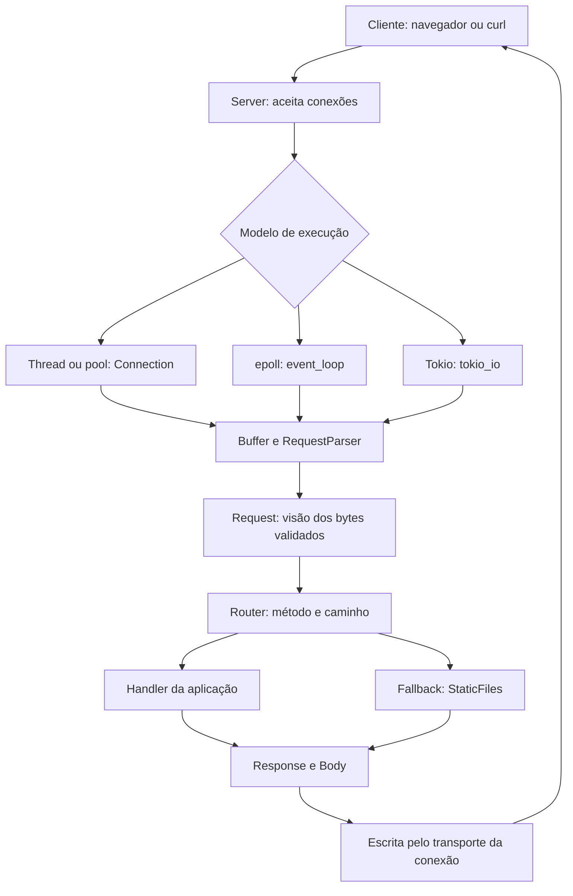

# Rust_server

Servidor HTTP escrito em Rust para estudar o que acontece entre uma conexão TCP e uma resposta enviada ao navegador. O projeto implementa o parser HTTP, o roteamento, a serialização das respostas e diferentes modelos de concorrência, sem usar um framework web.

A mesma aplicação pode atender conexões com uma thread por cliente, um pool de threads, um loop de eventos com `epoll` ou tarefas assíncronas com Tokio. Isso permite comparar as escolhas de execução mantendo as regras de HTTP e as rotas compartilhadas.

Além das rotas de demonstração, o servidor entrega arquivos estáticos, mantém conexões persistentes, transmite corpos em blocos e atende pedidos de partes de arquivos. O foco é tornar essas implementações compreensíveis e verificáveis por testes.

## Começando

Você precisa de uma instalação recente do Rust e do Cargo, compatível com a edição 2024. O modo `epoll` requer Linux. Os comandos abaixo partem da raiz do repositório:

```bash
cd rust_serv
cargo run --release -- --root ./public
```

Abra **http://127.0.0.1:8080** no navegador. Por padrão, o executável usa um pool de quatro workers e uma fila com capacidade para 64 conexões aguardando atendimento.

O `--` separa os argumentos do Cargo dos argumentos do servidor. O caminho de `--root` é relativo ao diretório em que o comando é executado; nesse exemplo, aponta para `rust_serv/public`.

Em outro terminal:

```bash
curl -i http://127.0.0.1:8080/health
curl 'http://127.0.0.1:8080/hello?name=Gabriel'
curl -i --data 'mensagem de teste' http://127.0.0.1:8080/echo
curl http://127.0.0.1:8080/stats
```

Pressione **Enter no terminal do servidor** para solicitar o encerramento ordenado. No modo Tokio, `Ctrl-C` também solicita esse encerramento. O servidor para de admitir novas conexões e aguarda o trabalho já admitido conforme as regras de cada modo.

## Vídeo de demonstração (opcional)

O repositório não inclui o vídeo de exemplo. Os testes HTTP, os eventos SSE e o experimento de Range sobre o HTML funcionam sem ele.

Para testar reprodução e busca por trechos de vídeo:

1. Use um vídeo seu ou baixe um MP4 que você tenha autorização para usar. Prefira um arquivo compatível com seu navegador, como MP4 com vídeo H.264 e áudio AAC.
2. Copie o arquivo para `rust_serv/public/Download.mp4`, respeitando maiúsculas e minúsculas. Se estiver usando outra pasta em `--root`, coloque `Download.mp4` nela.
3. Na página principal, em **Vídeo · Range**, clique em **Verificar vídeo local**. Depois, dê play e siga as instruções para inspecionar as respostas `206`.

Exemplo a partir da raiz do repositório:

```bash
cp /caminho/para/seu-video.mp4 rust_serv/public/Download.mp4
```

Não é necessário reiniciar o servidor após copiar o arquivo. Arquivos `*.mp4` diretamente em `rust_serv/public/` são ignorados pelo Git para manter os vídeos locais fora dos commits. Não use `git add -f` para incluí-los.

## O que já está implementado

- Parsing incremental de requests HTTP/1.0 e HTTP/1.1, com limites de tamanho e validação de mensagens malformadas.
- Conexões persistentes (*keep-alive*) e preservação de requests recebidas juntas na mesma conexão.
- Roteamento por método e caminho, `HEAD` automático para rotas `GET` e resposta `405` com `Allow`.
- Arquivos estáticos com tipos de conteúdo, `index.html`, revalidação por data e proteção contra caminhos fora da raiz.
- Corpos com `Content-Length` e transferência `chunked`, incluindo uma demonstração de Server-Sent Events (SSE).
- Intervalos de bytes de arquivos com `Range`, `206 Partial Content` e `416 Range Not Satisfiable`.
- Quatro modelos de concorrência, timeouts, métricas em `/stats` e logs configuráveis.
- Requests que emprestam os bytes já recebidos, reduzindo cópias durante o parsing.

O suporte é um subconjunto deliberado de HTTP. As limitações estão descritas ao final deste documento.

## Arquitetura: do socket à resposta

Um **socket** é o ponto de comunicação com o cliente. TCP transporta uma sequência de bytes; ele não entrega uma request HTTP pronta a cada leitura. Uma request pode chegar em várias leituras, e uma única leitura pode conter várias requests.

Por isso, a arquitetura separa o transporte, a interpretação da mensagem e a lógica da aplicação:



O fluxo de uma request é:

1. O servidor aceita a conexão e entrega seu atendimento ao modelo escolhido.
2. O transporte acumula bytes. O parser informa se falta conteúdo, se a mensagem é inválida ou se uma request completa já pode ser interpretada.
3. O parser identifica quantos bytes pertencem à request. O restante continua no buffer para a próxima mensagem.
4. O router procura o método e o caminho. Uma rota explícita tem prioridade; no executável, caminhos sem rota seguem para os arquivos estáticos.
5. O handler produz uma `Response`, com status, headers e uma descrição do corpo.
6. O transporte escreve a resposta e decide se continua atendendo ou encerra a conexão.

Por exemplo, em `GET /index.html`, o router chega ao fallback de arquivos. Ele resolve o caminho dentro de `public`, abre o arquivo e devolve um `Body::File`. O transporte envia o conteúdo em blocos, sem precisar carregar o arquivo inteiro em memória.

### Onde cada responsabilidade fica

Todos os caminhos abaixo são relativos a `rust_serv/`:

| Arquivo ou diretório | Responsabilidade |
| --- | --- |
| `src/main.rs` e `src/cli.rs` | Inicialização, argumentos, logs e escolha do modo de execução. |
| `src/server.rs` | Aceitação de conexões, integração dos modos, métricas e sinal de encerramento. |
| `src/connection.rs` | Atendimento bloqueante, buffer da conexão, timeouts e fechamento. |
| `src/thread_pool.rs` | Workers reutilizáveis e fila limitada de trabalhos. |
| `src/epoll.rs` e `src/event_loop.rs` | Integração com o mecanismo de prontidão do Linux e estado das conexões. |
| `src/tokio_io.rs` | Atendimento assíncrono com Tokio e limite de conexões admitidas. |
| `src/http/parser.rs` | Validação incremental, delimitação da mensagem e índices dos campos. |
| `src/http/borrowed_request.rs` | Visão da request que empresta dados do buffer. |
| `src/http/request.rs` | Representação com dados próprios, mantida para compatibilidade. |
| `src/http/response.rs` e `src/http/body.rs` | Status, headers, serialização e produção do corpo em blocos. |
| `src/http/uri.rs`, `date.rs` e `range.rs` | Decodificação de URI, datas HTTP e intervalos de bytes. |
| `src/router.rs` e `src/routes.rs` | Seleção de handlers e rotas de demonstração. |
| `src/static_files.rs` | Resolução de arquivos, metadados, cache e respostas parciais. |
| `src/error.rs` e `src/stats.rs` | Tratamento de erros e contadores do servidor. |
| `tests/` | Testes de protocolo, integração, propriedades, lifetimes e medições. |
| `public/` | Conteúdo servido pelo executável padrão. |

Essa divisão permite alterar como uma conexão espera por dados sem reescrever o parser ou as regras das rotas. Há implementações específicas de leitura e escrita para cada transporte, mas a interpretação HTTP e os tipos da aplicação são compartilhados.

## Por que existem quatro modos de execução?

Concorrência significa conseguir lidar com vários trabalhos em andamento. Ela não exige que todos estejam usando CPU ao mesmo tempo: muitos clientes estão apenas esperando dados ou lendo lentamente.

| Modo | Como atende | Escolha e consequência |
| --- | --- | --- |
| `thread` | Cria uma thread para cada conexão. | Fluxo simples de acompanhar, mas cada conexão mantém uma thread, inclusive enquanto espera. |
| `pool` | Distribui conexões entre um número fixo de workers. | Limita threads e a fila de espera; uma conexão persistente ocupa seu worker durante o atendimento. |
| `epoll` | Um loop acompanha quais sockets estão prontos para leitura ou escrita. | Evita uma thread por conexão, mas exige guardar explicitamente o progresso de cada uma. Disponível no Linux. |
| `tokio` | Usa tarefas assíncronas e operações de I/O com `await`. | Uma tarefa pode suspender enquanto espera o socket, permitindo que as threads do runtime executem outras tarefas. |

Experimente um comando por vez, a partir de `rust_serv/`:

```bash
cargo run --release -- --mode thread
cargo run --release -- --mode pool --workers 4 --queue 64
cargo run --release -- --mode epoll --trigger level
cargo run --release -- --mode epoll --trigger edge
cargo run --release -- --mode tokio --max-connections 16384
```

No pool, a fila limitada impede o acúmulo ilimitado de conexões aguardando um worker. Quando ela está cheia, a conexão excedente é rejeitada; isso não garante uma resposta HTTP `503`, pois a request ainda não foi interpretada.

No `epoll`, **level-triggered** continua notificando enquanto houver prontidão. **Edge-triggered** exige consumir o trabalho disponível até a operação indicar que bloquearia (`WouldBlock`), para não depender de uma nova notificação que pode não chegar. Leituras e escritas parciais precisam conservar seu progresso entre eventos.

O loop do `epoll` ainda executa handlers e operações de arquivo síncronas; uma operação demorada pode atrasar outras conexões. No Tokio, handlers síncronos são encaminhados a `spawn_blocking`, separando esse trabalho das threads que executam tarefas assíncronas. O limite de conexões é controlado por um semáforo: cada conexão admitida mantém uma permissão até terminar.

O router é compartilhado por `Arc`, que permite vários donos do mesmo valor. Os handlers exigem `Send + Sync` porque podem ser acessados por diferentes threads. Estado mutável compartilhado precisa de sincronização; `/counter`, por exemplo, usa um contador atômico.

**Detalhe da API:** o executável escolhe `pool` por padrão. Já `Server::bind` na biblioteca começa com `ThreadPerConnection`, até que outra execução seja selecionada.

## Decisões de implementação

### Parsing incremental e limites explícitos

O parser conserva estado entre leituras em vez de exigir que toda a mensagem chegue de uma vez. Ele também distingue uma mensagem incompleta de uma mensagem inválida: esperar mais bytes resolve a primeira situação, mas não a segunda.

A delimitação do corpo precisa ser inequívoca. O servidor rejeita `Content-Length` repetido e a combinação de `Content-Length` com `Transfer-Encoding`. Aceitar interpretações conflitantes faria componentes diferentes discordarem sobre onde termina uma request e começa a próxima.

| Limite padrão | Valor | Finalidade |
| --- | --- | --- |
| Bloco inicial da request, incluindo linha inicial e headers | 8 KiB | Limitar a memória usada antes do corpo. |
| Corpo recebido | 1 MiB | Limitar o conteúdo acumulado por request, inclusive após decodificar chunked. |
| Espera ociosa | 5 s | Encerrar conexões sem uma nova request. |
| Recebimento de uma request iniciada | 10 s | Evitar que bytes enviados muito lentamente prolonguem indefinidamente a leitura. |
| Espera de escrita | 10 s | Limitar a espera por progresso na saída, conforme o transporte. |
| Requests por conexão | 100 | Limitar a reutilização de uma mesma conexão. |

Os limites de parsing ficam em `http/parser.rs`. Os de conexão ficam em `connection::Config`; somente o timeout ocioso é exposto pela CLI atual. O timeout de escrita não representa um prazo total de dez segundos para transmitir um arquivo inteiro.

### Emprestar bytes em vez de copiar cada campo

Uma implementação direta pode transformar o caminho, cada header e o corpo em novas `String` ou `Vec`. Isso facilita a propriedade dos dados, mas repete alocações e cópias.

A API atual usa `http::Request<'a>` como uma visão dos bytes já validados. O lifetime `'a` expressa que essa visão não pode sobreviver aos dados que referencia. O parser guarda índices dos campos; as referências são construídas quando o buffer está disponível. Assim, evita-se uma estrutura que precisaria guardar referências para dentro de si mesma.

No caminho Tokio, um prefixo de `BytesMut` é separado e congelado em `Bytes`. Um `RequestFrame` mantém esses bytes vivos enquanto o trabalho é movido para o handler. O buffer restante pode continuar representando outras requests.

Isso reduz cópias no parsing, mas não torna todo o servidor livre de cópias ou alocações. Um corpo chunked precisa ser reconstruído, os índices ocupam memória e handlers podem criar novos dados. A API antiga, `http::request::Request`, continua disponível com dados próprios; a adaptação para handlers antigos pode copiar os campos.

### Separar a resposta da forma de transmitir seu corpo

`Response` contém status, headers e um `Body`. O corpo pode ser vazio, bytes em memória, um trecho de arquivo ou o stream de eventos da demonstração.

Essa separação permite responder com um arquivo grande sem criar um `Vec` do tamanho do arquivo. O cursor do corpo produz blocos de até 64 KiB para bytes e arquivos; um corpo de arquivo também registra o deslocamento e o comprimento a transmitir.

Quando o comprimento é conhecido, a serialização usa `Content-Length`. Para o stream de comprimento não conhecido, usa `Transfer-Encoding: chunked`: cada bloco tem seu tamanho informado, e um bloco final encerra a mensagem. A serialização controla esses headers para impedir que um handler declare um enquadramento incompatível com o corpo.

**Backpressure** é o efeito de um consumidor lento limitar o produtor. O envio acompanha o progresso de escrita, em vez de preparar todo o arquivo de uma vez. No transporte assíncrono, esperar o socket permite que outras tarefas avancem.

`HEAD` reutiliza a seleção da rota `GET`, mas o transporte omite o corpo. Isso mantém a lógica de metadados concentrada no mesmo handler.

### Arquivos, cache e intervalos

`StaticFiles` resolve caminhos dentro de uma raiz canonicalizada, rejeita componentes `.` e `..`, oculta caminhos com componentes iniciados por ponto e verifica se o destino permanece dentro da raiz, inclusive após resolver links simbólicos.

Diretórios recebem uma barra final por redirecionamento e são atendidos por `index.html`; não há listagem automática. O tipo de conteúdo é escolhido pela extensão.

Para revalidação, o servidor envia `Last-Modified` e pode responder `304 Not Modified` quando `If-Modified-Since` indica que o cliente já tem a versão atual. Isso economiza a transmissão do corpo.

`Range: bytes=0-99` solicita somente os primeiros cem bytes de um arquivo. O servidor pode responder `206` com `Content-Range`, ou `416` quando o intervalo não pode ser atendido. Também aceita intervalos abertos e sufixos, como `bytes=100-` e `bytes=-100`.

O `ETag` é derivado de metadados do arquivo. `If-Range` com esse ETag permite enviar o intervalo somente se a versão ainda corresponder; caso contrário, o arquivo é enviado inteiro. A implementação atual atende um intervalo por request, não respostas multipart com vários intervalos.

## Rotas e exemplos

Estas são as rotas do executável padrão:

| Método e caminho | Comportamento |
| --- | --- |
| `GET /health` | Retorna `ok` para uma verificação simples. |
| `GET /hello?name=Ana` | Retorna uma saudação com o parâmetro decodificado. |
| `POST /echo` | Devolve os bytes recebidos e o tipo de conteúdo informado. |
| `GET /headers` | Mostra os headers recebidos. |
| `GET /counter` | Incrementa um contador compartilhado entre as conexões. |
| `GET /stream` | Envia uma demonstração SSE com dez eventos, em intervalos de 250 ms. |
| `GET /stats` | Retorna contadores do servidor em JSON; rota reservada pelo `Server`. |
| `GET /` e caminhos sem rota explícita | Procuram arquivos sob `--root`; `/` serve `index.html`. |

Rotas `GET` também aceitam `HEAD`. O roteamento é por caminho exato, sem parâmetros como `/users/:id`. Um caminho registrado com outro método produz `405`; ele não é reinterpretado como arquivo estático.

```bash
# Metadados sem transmitir o corpo do arquivo
curl -I http://127.0.0.1:8080/index.html

# Apenas os primeiros cem bytes
curl -i -H 'Range: bytes=0-99' http://127.0.0.1:8080/index.html

# Exibir os eventos conforme chegam, sem buffering do curl
curl -N http://127.0.0.1:8080/stream
```

Os contadores de `/stats` incluem conexões aceitas, em fila, ativas, concluídas e rejeitadas, além de requests, respostas, erros e panics. Cada contador é atômico, mas a leitura do conjunto não é uma transação: durante atividade concorrente, os valores podem refletir instantes ligeiramente diferentes.

### Adicionando uma rota

Em [`rust_serv/src/routes.rs`](rust_serv/src/routes.rs), acrescente uma chamada à construção do router em `application_router()`:

```rust
.route_borrowed(Method::Get, "/sobre", |_request| {
    Response::text(Status::Ok, "Servidor HTTP de estudo em Rust\n")
})
```

`Method`, `Response` e `Status` já são importados nesse módulo. O handler recebe a visão emprestada da request e devolve uma resposta; leitura do socket, serialização e keep-alive continuam sob responsabilidade do servidor. Como essa rota entra no router da aplicação, ela tem prioridade sobre um eventual arquivo com o mesmo caminho.

## Configuração

Todas as opções recebem um valor:

| Opção | Padrão | Uso |
| --- | --- | --- |
| `--root` | `./public` | Diretório dos arquivos estáticos. |
| `--addr` | `127.0.0.1:8080` | Endereço e porta de escuta. |
| `--mode` | `pool` | `thread`, `pool`, `epoll` ou `tokio`. |
| `--idle-timeout` | `5` | Segundos de espera ociosa. |
| `--workers` | `4` | Quantidade de workers do pool. |
| `--queue` | `64` | Capacidade da fila do pool. |
| `--trigger` | `level` | `level` ou `edge`, usado pelo epoll. |
| `--max-connections` | `16384` | Limite de conexões admitidas no Tokio. |

Exemplo com outra porta e logs mais detalhados:

```bash
RUST_LOG=rust_serv=debug cargo run --release -- \
  --mode tokio --addr 127.0.0.1:8081 --idle-timeout 30
```

`tracing` registra eventos, e `tracing-subscriber` configura sua apresentação e filtragem por `RUST_LOG`. As outras dependências de execução têm papéis específicos: `bytes` administra buffers compartilháveis, `libc` permite a integração de baixo nível com Linux e Tokio fornece runtime e I/O assíncrono. O parser HTTP do servidor é implementado no próprio projeto.

## Testes e medições

Execute a partir de `rust_serv/`:

```bash
cargo test
RUST_SERV_TEST_MODE=tokio cargo test
cargo fmt --check
cargo clippy --all-targets -- -D warnings
```

As suítes de integração abrem conexões TCP locais. A variável `RUST_SERV_TEST_MODE` seleciona Tokio nos testes que usam o suporte compartilhado; ela não é uma opção de execução do servidor.

Os testes cobrem mensagens fragmentadas, conexões persistentes, métodos e status, concorrência, arquivos, traversal, chunked, streaming e Range. Há também propriedades com entradas geradas por `proptest` e exemplos que devem falhar ao compilar para verificar restrições de lifetimes.

Para explorar especificamente o custo do parser:

```bash
cargo test --test zero_copy --test lifetimes
cargo test --release --test phase12_allocations
cargo bench --bench parser
```

O benchmark usa Criterion e compara o parser atual com uma referência anterior e com `httparse`. Essa biblioteca é uma dependência de desenvolvimento, não o parser usado pelo servidor. As comparações precisam considerar que os parsers não têm necessariamente o mesmo contrato de validação.

Há um pacote separado de fuzzing em [`rust_serv/tests/fuzz`](rust_serv/tests/fuzz), com dependências e toolchain próprios. Procedimentos, medições e resultados históricos estão no [guia das fases 7 a 12](rust_serv/NOTES.md). Números de alocações por parse não representam o consumo total de memória do servidor, e benchmarks em memória não medem o desempenho completo da rede.

## Escopo e limitações

Este é um projeto de estudo com implementações explícitas das camadas do servidor. Seu estado atual tem limites que também ajudam a entender as escolhas:

- Não implementa TLS/HTTPS, HTTP/2, HTTP/3 ou WebSocket.
- Handlers são síncronos; Tokio os executa por `spawn_blocking`, mas não transforma automaticamente seu trabalho em operações assíncronas canceláveis.
- O corpo recebido é limitado e acumulado antes do handler. Streaming de resposta não significa streaming de upload para a aplicação.
- O stream SSE é uma demonstração finita, não uma API genérica de publicação de eventos.
- Arquivos usam leitura em blocos; a redução de cópias do parser não equivale a uma transferência de arquivos com `sendfile`.
- Range é aplicado a `GET`; `HEAD` descreve o arquivo completo. Intervalos multipart não são implementados. `If-Range` reconhece o ETag exato, e a revalidação por `If-None-Match` não está implementada.
- A verificação do caminho e a abertura do arquivo são operações separadas. Alterações concorrentes no filesystem podem criar uma janela de corrida; os escritores locais da raiz servida precisam ser confiáveis. O ETag de metadados também pressupõe atualização apropriada desses metadados.
- Encerramento ordenado espera trabalho admitido; um handler síncrono arbitrário que nunca termina não pode ser interrompido com segurança pelo servidor.

## Um caminho para estudar o código

Comece por [`main.rs`](rust_serv/src/main.rs) e [`routes.rs`](rust_serv/src/routes.rs) para ver como a aplicação é montada. Depois, acompanhe [`router.rs`](rust_serv/src/router.rs) e [`response.rs`](rust_serv/src/http/response.rs): eles mostram como uma request vira uma resposta.

Em seguida, leia [`connection.rs`](rust_serv/src/connection.rs) junto com [`parser.rs`](rust_serv/src/http/parser.rs) para entender fragmentação, buffers e keep-alive. Compare então [`thread_pool.rs`](rust_serv/src/thread_pool.rs), [`event_loop.rs`](rust_serv/src/event_loop.rs) e [`tokio_io.rs`](rust_serv/src/tokio_io.rs) para observar como muda a espera por I/O.

Por último, explore [`borrowed_request.rs`](rust_serv/src/http/borrowed_request.rs) e os testes de lifetimes. O [guia de notas](rust_serv/NOTES.md) explica a evolução dessas decisões, seus experimentos e os resultados de cada fase.

## Licença

O texto da licença GNU GPL versão 3 está em [LICENSE](LICENSE).
